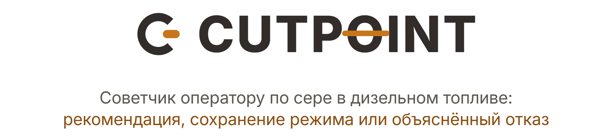
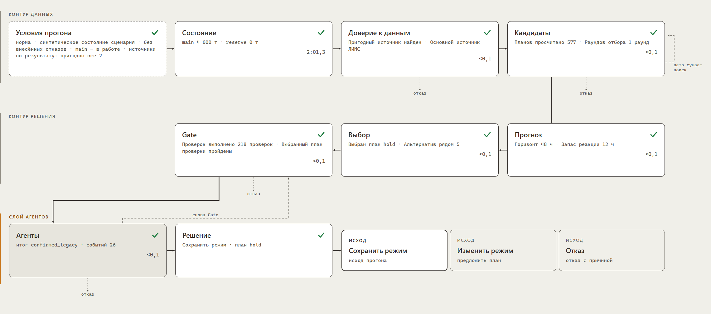
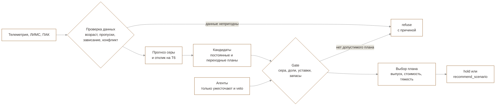

<p align="center">
  <picture>
    <source media="(prefers-color-scheme: dark)" srcset="docs/readme/banner.dark.png">
    
  </picture>
</p>

<p align="center">
  Оператор цепочки АВТ → гидроочистка → смешение дизельного топлива получает от мультиагентной системы
  ответ: изменить режим, сохранить его или отказаться решать, с причиной и измерением, которое изменило бы вердикт.
</p>

<p align="center">
  <!-- readme:buttons -->
  <a href="#запуск"><picture><source media="(prefers-color-scheme: dark)" srcset="docs/readme/cta-run.dark.png"></picture></a>
  <br>
  <a href="docs/decision.md"><picture><source media="(prefers-color-scheme: dark)" srcset="docs/readme/cta-decision.dark.png"></picture></a>
  <a href="docs/README.md"><picture><source media="(prefers-color-scheme: dark)" srcset="docs/readme/cta-docs.dark.png"></picture></a>
  <!-- /readme:buttons -->
</p>

<p align="center">
  <!-- readme:status -->
  <a href="#результаты"><picture><source media="(prefers-color-scheme: dark)" srcset="docs/readme/badge-status-1.dark.png"></picture></a>
  <a href="#зачем-это"><picture><source media="(prefers-color-scheme: dark)" srcset="docs/readme/badge-status-2.dark.png"></picture></a>
  <br>
  <a href="#запуск"><picture><source media="(prefers-color-scheme: dark)" srcset="docs/readme/badge-status-3.dark.png"></picture></a>
  <a href="#запуск"><picture><source media="(prefers-color-scheme: dark)" srcset="docs/readme/badge-status-4.dark.png"></picture></a>
  <a href="LICENSE"><picture><source media="(prefers-color-scheme: dark)" srcset="docs/readme/badge-status-5.dark.png"></picture></a>
  <!-- /readme:status -->
</p>

<p align="center">
  <!-- readme:stack -->
  <picture><source media="(prefers-color-scheme: dark)" srcset="docs/readme/badge-stack-1.dark.png"></picture>
  <picture><source media="(prefers-color-scheme: dark)" srcset="docs/readme/badge-stack-2.dark.png"></picture>
  <br>
  <picture><source media="(prefers-color-scheme: dark)" srcset="docs/readme/badge-stack-3.dark.png"></picture>
  <picture><source media="(prefers-color-scheme: dark)" srcset="docs/readme/badge-stack-4.dark.png"></picture>
  <br>
  <picture><source media="(prefers-color-scheme: dark)" srcset="docs/readme/badge-stack-5.dark.png"></picture>
  <!-- /readme:stack -->
</p>

<p align="center">
  <!-- readme:nav -->
  <a href="#зачем-это"><picture><source media="(prefers-color-scheme: dark)" srcset="docs/readme/badge-nav-1.dark.png"></picture></a>
  <a href="#как-это-работает"><picture><source media="(prefers-color-scheme: dark)" srcset="docs/readme/badge-nav-2.dark.png"></picture></a>
  <a href="#попробовать-за-две-минуты"><picture><source media="(prefers-color-scheme: dark)" srcset="docs/readme/badge-nav-3.dark.png"></picture></a>
  <br>
  <a href="#результаты"><picture><source media="(prefers-color-scheme: dark)" srcset="docs/readme/badge-nav-4.dark.png"></picture></a>
  <a href="#запуск"><picture><source media="(prefers-color-scheme: dark)" srcset="docs/readme/badge-nav-5.dark.png"></picture></a>
  <a href="#устройство"><picture><source media="(prefers-color-scheme: dark)" srcset="docs/readme/badge-nav-6.dark.png"></picture></a>
  <a href="#ограничения"><picture><source media="(prefers-color-scheme: dark)" srcset="docs/readme/badge-nav-7.dark.png"></picture></a>
  <!-- /readme:nav -->
</p>

<p align="center">
  
  <br>
  <sub>Схема расчёта на прогоне: каждый узел раскрывается и показывает, что этап посчитал; пунктиром — ветви отказа.</sub>
</p>

> **LLM не может ослабить ограничение.** Агенты выбирают только из заранее допустимых вариантов, а
> жёсткие пределы, от серы ≤10 мг/кг до запасов резервуаров, проверяет детерминированный Gate. Код
> принимает от агентов лишь ужесточения и veto, финальный план перепроверяется.

## Зачем это

Оператор держит серу в дизельном топливе в пределах нормы, глядя на телеметрию, лабораторию ЛИМС с
задержкой в часы и поточный анализатор ПАК, который может зависнуть. Ошибка в одну сторону — брак,
в другую — лишняя жёсткость режима и потерянный выпуск.

Система работает на реальных данных завода: **189 217 десятиминутных строк телеметрии за 2023–2026
годы**, лабораторные анализы ЛИМС и поточный анализатор ПАК. Она проверяет данные, прогнозирует серу,
сравнивает планы и **отвечает одним из трёх вердиктов**. Название — из термина перегонки: cut point,
температура отсечки, граница между фракциями. Система проводит такую же границу между допустимым и
недопустимым.

## Как это работает



<table>
<tr>
<td valign="top" width="33%">

**1. Каждое число знает происхождение**

У любой величины есть метка `given`, `derived`, `scenario` или `open`. Расчёт, которому нужен
`open`, возвращает «неизвестно» и не подставляет правдоподобную константу.

<sub>Бейджи происхождения в узле 00 схемы расчёта</sub>

</td>
<td valign="top" width="33%">

**2. Отказ — это ответ, а не сбой**

Если данные непригодны или допустимого плана нет, система говорит об этом и называет измерение,
которое изменило бы вердикт. На срезе 16.04.2026 с устаревшей лабораторией правильный ответ — `refuse`.

<sub>Три вердикта — в [описании решения](docs/decision.md#три-вердикта)</sub>

</td>
<td valign="top" width="33%">

**3. Границы слоёв проверяет тест**

203 модуля разложены на `domain`, `application`, `infrastructure` и ещё четыре слоя. Направления
зависимостей — не договорённость: AST-проверки падают, если слой нарушит границу.

<sub>`tests/architecture/`, слои — в [архитектуре](docs/architecture.md)</sub>

</td>
</tr>
</table>

## Попробовать за две минуты

После [запуска](#запуск) откройте http://127.0.0.1:8765/.

| | Что сделать | Что увидите |
|---|---|---|
| 1 | Выбрать сцену «плохие данные» и нажать «Запустить расчёт» | Этапы приходят по мере счёта, события агентов видны, итог — `refuse` с причиной |
| 2 | Раскрыть узел 00 схемы | Условия расчёта, у каждого числа бейдж происхождения |
| 3 | «Закрепить для сравнения», затем «Что изменится, если…» и отключить резервуар | Парное сравнение двух решений с оговорками о несопоставимости |

Шесть сцен демонстрации, карта компромиссов и запись прогона с контрольной суммой — в
[описании решения](docs/decision.md).

## Результаты

Прогноз выбран на пяти rolling-периодах до 2026 года и один раз проверен на 2026 на одинаковых 233
пробах. Отклик оценивается по данным строго до момента решения, без утечки из будущего.

| Метрика | CUTPOINT | База |
|---|---|---|
| MAE прогноза серы после гидроочистки | **1,616 мг/кг** | 1,802 мг/кг, последний пригодный ПАК без поправки |
| Отклик серы на температуру реактора T6 | **β = −0,4227 мг/кг/°C** | доверительный интервал [−0,4768; −0,389] |

Пороги доверия к источникам выведены из истории, а не заданы руками: ЛИМС устарел старше 48 ч,
ПАК — старше 30 мин, конфликт ПАК–ЛИМС — расхождение выше 4,75 мг/кг (95-й перцентиль).

**Где слабее всего.** Числа относятся к указанным выборкам и конфигурациям, а не к доказанному
эффекту на производстве. Протоколы — в [прогнозе и доказательствах](docs/forecast-evidence.md) и
[модели отклика](docs/response-model.md).

<details>
<summary><b>Пересчитать все числа раздела</b></summary>
<br>

```bash
uv run neftecode train    # прогноз, отклик и пороги доверия; нужен каталог task/ с данными завода
```

Методики и сырые результаты всех экспериментов — в [research](research/README.md).

</details>

## Запуск

Нужны Python 3.12 и [uv](https://docs.astral.sh/uv/). Внешние API и ключи не нужны.

```bash
uv sync --frozen
AGENTIC_DECISION_ENABLED=0 uv run neftecode serve
```

Интерфейс — http://127.0.0.1:8765/. Собранная версия интерфейса лежит в Git, поэтому Node.js не нужен.

<details>
<summary><b>Тесты, агенты, Docker и четыре процесса</b></summary>
<br>

```bash
LLM_PROVIDER=scripted uv run pytest -q     # 1551 тест, сеть не нужна
uv run neftecode agent-demo                 # механика агентов без языковой модели
docker compose up --build                   # стек в контейнерах
docker compose -f docker-compose.offline.yml up --build   # закрытый контур
uv run neftecode-stack --root . --artifacts artifacts      # data 8766, model 8767, decision 8768, gateway 8765
```

Агентный слой по умолчанию работает с провайдером Z.AI; `LLM_PROVIDER=local` переключает на локальный
OpenAI-совместимый endpoint. Ключи — в окружении или `.env` по шаблону [.env.example](.env.example).
Все команды CLI и какие данные им нужны — в [командах и данных](docs/commands.md).

</details>

## Устройство

Ядро на Python разложено на слои с проверяемыми границами, поверх работают три агента:
`OrchestratorAgent`, `QualityAgent` и `ReliabilityAgent`. Ключевое решение, допустим ли план,
принимает детерминированный Gate в `application/use_cases/decision/`.

| Вопрос | Документ |
|---|---|
| Как считается решение и чем заканчивается прогон | [Как принимается решение](docs/decision.md) |
| Как устроено решение | [Архитектура](docs/architecture.md) и [карта кода](docs/code-tour.md) |
| Что происходит при расчёте | [Конвейер](docs/pipeline.md) и [контракты сервисов](docs/services.md) |
| Выполнено ли ТЗ | [Карта требований](docs/requirements-map.md) |
| Какие периоды выброшены и почему | [Исключённые периоды](docs/excluded-periods.md) |

## Ограничения

- **Чистый клон работает на синтетике.** Данные завода `task/` и сохранённые срезы `artifacts/` в
  Git не входят; без них доступны синтетические сцены, benchmark и интерфейс, и система говорит об
  этом сама.
- **Глобальная оптимальность не заявляется.** Поиск планов дискретный с бюджетом 1200, а политика
  `min_useful_gain` намеренно удерживает режим при малой выгоде.
- **Живые вызовы модели медленные и неповторяемые.** Прогон с внешней LLM занимает минуты,
  `temperature=0` не гарантирует повторяемость; детерминированный режим — `AGENTIC_DECISION_ENABLED=0`.

<p align="center">
  <picture><source media="(prefers-color-scheme: dark)" srcset="docs/readme/mark.dark.png"></picture>
  <br>
  <sub>Команда Ullax, хакатон «Нефтекод», 2026. Лицензия <a href="LICENSE">MIT</a>.</sub>
</p>
