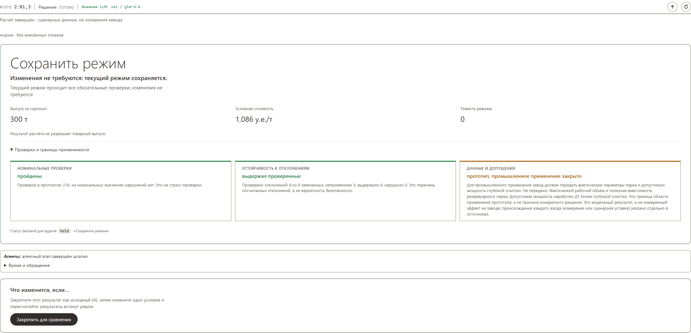
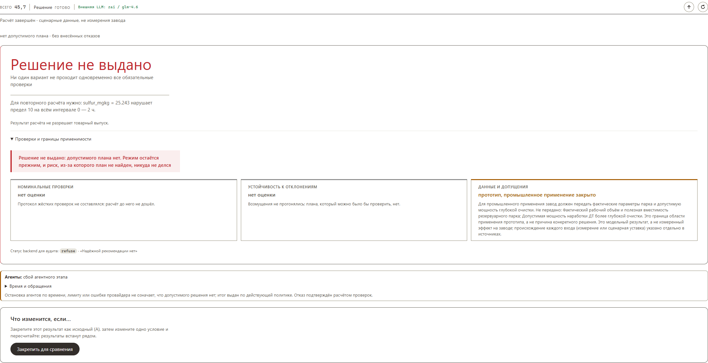
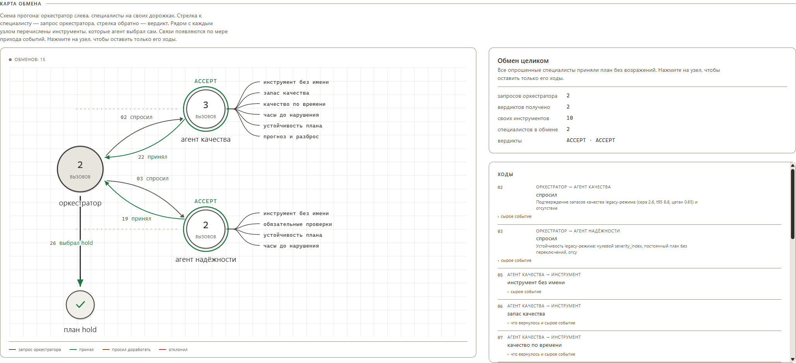

# Как принимается решение

Что считает планировщик, что проверяет Gate, как работают агенты и чем заканчивается прогон. Конвейер по коду — в [pipeline.md](pipeline.md).

## Расчёт плана

Планировщик строит постоянные и переходные планы, считает качество, массовый баланс,
выпуск, условную стоимость и тяжесть режима. **Gate** проверяет серу ≤10 мг/кг,
объявленные свойства продукта, доли компонентов (сумма = 100%), границы уставок,
доступность компонентов и ограничения запасов. Неизвестное обязательное условие
не считается выполненным.

Парк резервуаров моделируется партиями по стадиям `filling → awaiting_passport → ready
→ draining`: проверяются вместимость, 12 часов паспортизации, предел слива за 24 часа,
массовый баланс и прогноз паспорта наливаемой партии.

Порядок выбора плана: **выпуск → стоимость → тяжесть режима → число изменений →
идентификатор**. Политика `min_useful_gain` удерживает текущий режим при малой экономии.
Поиск дискретный с бюджетом 1200; глобальная оптимальность не заявляется.

**Агенты.** `OrchestratorAgent`, `QualityAgent` и `ReliabilityAgent` работают поверх ядра.
Специалисты получают ограниченный набор инструментов и возвращают мнения со ссылками на
результаты. Код применяет только разрешённые ужесточения и veto — ослабить ограничение
агент не может. Финальный план перепроверяется. Если ошибка случилась после принятого
ограничения, fallback сохраняет ограничение и выбирает оставшийся план либо отказывает.

По умолчанию агентный слой включён с провайдером Z.AI; `AGENTIC_DECISION_ENABLED=0`
отключает его, `LLM_PROVIDER=local` переключает на локальный OpenAI-совместимый endpoint.
Ключи — в окружении или локальном `.env`, в Git не входят. Живые вызовы занимают минуты;
`temperature=0` не гарантирует повторяемость внешней модели.

**Четыре процесса** запускает `uv run neftecode-stack`: data 8766, model 8767,
decision 8768, gateway 8765. Gateway реализует `/api/stream` и передаёт этапы и события
агентов по мере расчёта. HTTP-протокола отмены у decision-service нет: кнопка прекращает
показ, сервер может продолжать счёт.

## Агентный слой и LLM

Решение работает с агентным слоем, который использует LLM. LLM помогает
проводить разбор условий, выбирать действия и объяснять результат, а детерминированное
ядро, Gate и жёсткие ограничения проверяют каждого кандидата и не позволяют модели
ослабить требования.

Если нужен полностью детерминированный прогон без внешней модели и ключа,
в `.env` укажите:

```dotenv
AGENTIC_DECISION_ENABLED=0
LLM_PROVIDER=scripted
```

В этом режиме решение принимает детерминированное ядро по правилам и расчётным моделям;
LLM не вызывается. Шаблон настроек находится в [.env.example](../.env.example).

## Три вердикта

Система отвечает одним из трёх исходов, и каждый выглядит по-своему.

<p align="center">
  
</p>

<p align="center">
  <sub><b>Сохранить режим.</b> Текущий режим проходит все 218 обязательных проверок,<br/>
  выгода от вмешательства не покрывает риск — система не трогает установку.<br/>
  Под вердиктом: номинальные проверки, устойчивость к отклонениям и граница применимости.</sub>
</p>

<p align="center">
  
</p>

<p align="center">
  <sub><b>Решение не выдано.</b> Отказ назван числом, а не общей фразой: сера 25,243 мг/кг<br/>
  против предела 10 на всём интервале 0 — 2 ч. Сказано и то, что режим остаётся прежним,<br/>
  и что риск, из-за которого план не найден, никуда не делся.</sub>
</p>

<p align="center">
  <sub>Третий исход — <b>изменить режим</b>: система предлагает конкретный план с уставками,<br/>
  когда он и допустим, и заметно лучше текущего. На сценарных данных он выпадает реже двух<br/>
  других: если текущий режим проходит проверки, система намеренно его не трогает.</sub>
</p>


## Измерения и пороги доверия

<table>
<tr>
<td width="50%" valign="top">

**Прогноз серы после гидроочистки**

**MAE 1.802 → 1.616 мг/кг**

Последний пригодный ПАК с медианной поправкой
по 20 доступным парам ЛИМС−ПАК. Метод выбран
на **пяти rolling-периодах** до 2026 года, затем
**один раз** проверен на 2026 — на одинаковых
233 пробах.

[Протокол и доказательства →](forecast-evidence.md)

</td>
<td width="50%" valign="top">

**Отклик серы на температуру реактора**

**β = −0.4227 мг/кг/°C**

Доверительный интервал **[−0.4768; −0.389]**
с объявленной областью применимости.
Оценивается по `ht.T6` на данных строго
до момента решения — без утечки из будущего.

[Модель отклика →](response-model.md)

</td>
</tr>
</table>

**Пороги доверия к источникам выведены из истории, а не заданы руками.** ТЗ требует
проверку данных, но конкретных чисел не даёт — мы посчитали их по обучающему периоду:

| Правило | Порог | Откуда |
|---|---|---|
| ЛИМС устарел | старше **48 ч** | два суточных интервала отбора проб |
| ПАК устарел | старше **30 мин** | три периода опроса |
| Датчик завис | **4** одинаковых показания подряд | так редко бывает у живого прибора |
| Конфликт ПАК–ЛИМС | расхождение выше **4.75 мг/кг** | 95-й перцентиль расхождения |
| Телеметрия неполна | от **10** пропавших датчиков из 96 | провал между режимом и сбоем опроса |

**Шесть сцен демонстрации** (на комплекте с сохранёнными срезами):

| Сцена | Момент | Ответ ядра |
|---|---|---|
| Нормальный режим | 05.01.2026 08:00 | `hold` |
| Ухудшение сырья | синтетическая | `hold` |
| Зависший анализатор | 20.07.2026 19:10 | `hold` с резервным источником |
| Устаревшая лаборатория и сломанный ПАК | 16.04.2026 10:10 | `refuse` |
| Резервуар выведен из работы | реальный срез + изменение доступности | `recommend_scenario` |
| Риск ухудшения качества | 24.07.2026 03:00 | `recommend_scenario` |

Изменение входа не обязано менять действие: если текущий режим допустим, а выгода мала,
система сохраняет его. Это намеренное поведение, а не отсутствие реакции.

<p align="center">
  
</p>

<p align="center">
  <sub>Карта обмена строится во время прогона: слева оркестратор, справа специалисты,<br/>
  рядом с каждым — инструменты, которые агент выбрал сам. Стрелка к специалисту — запрос,<br/>
  обратно — вердикт. Здесь оба специалиста дали ACCEPT, и план <code>hold</code> прошёл.</sub>
</p>
